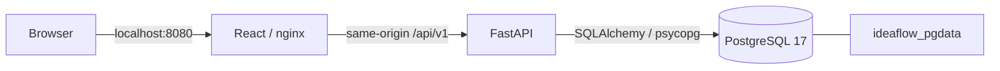

Current amendment (2026-10-09): shared User/Admin workspace, user-created optional locations/categories, audited rename/merge, no bootstrap reference data. Classification changes and idea mutations use one transaction and a shared PostgreSQL advisory lock to avoid creation/merge races in this local workspace. Other architecture and financial/workflow protections remain.

# Architecture

Idea removal (schema 0005) is reversible archival in the existing three services. All visible ideas share the same workflow, queries and reporting; the legacy Test flag has no effect and no current control. Shared selection excludes removed records. Admin remove/restore commands take a reason, explicit confirmation and optimistic idea version under the transactional lock/event append. Removed details are Admin-only/read-only. Restoration validates active owners/open task assignees and records requested reassignment. All related financial/task/comment/import/audit evidence remains in PostgreSQL. No purge, reset, extra service or automatic cleanup.

Only frontend publishes a loopback port. Compose project and durable volume names are stable. Three production services run with healthchecks and restart policies. Transient build, test and restore tooling does not change the deployed stack. React fonts, Plotly assets and graph libraries are bundled locally. No runtime internet API, CORS service or external worker is needed.

Backend initialization runs Alembic under the migration database role, creates the restricted application login if missing, grants table privileges with audit update/delete/truncate revoked, and creates the bootstrap Admin only. Subsequent startups preserve existing credentials and records. API runtime uses `ideaflow_app`; migration secrets never enter frontend assets. Database triggers reject audit mutation and financial snapshot content/schedule mutation. PostgreSQL owns relational constraints and Numeric money storage.

Mutations lock the idea row, check the submitted record version, validate domain rules, change business rows and append events before committing the transaction. An invalid command rolls back both changes and events. Per-case sequence is computed while holding the case lock and constrained unique. Each event updates idea version, so multi-event commands can advance it more than one integer. No hard-delete idea route exists. Period updates also check the result version. Approval and Analysis → Approved share one transaction. Result correction and verification revocation share one transaction. Rework from Validation reopens required tasks, lowers progress and clears completion, preserving prior verification/history.

Sessions store only a SHA-256 digest of a random cookie token; Argon2 hashes passwords. Cookies are HttpOnly, SameSite Strict, and secure when served over HTTPS. Mutations require the session CSRF header and reject cross-origin browser requests. Every ordinary action supplies actor/time from the session/server; typed inputs forbid extra audit fields. The special Admin importer allows historical actors/timestamps, validates chronology and replays the same domain services with visible fictional provenance. No credentials are returned by the importer.

Financial definitions are implemented in `app/financial.py`. Dashboard services read current valid approved schedules, keep terminal historical outcomes available, separate net benefit and implementation spend, and report matched reporting/verification coverage. Plan snapshots remain viewable after superseding or invalidating. Live calculations are adequate for this local portfolio scale; no stale metrics cache exists.

Process discovery sorts full selected-case lifecycle histories by `(occurred_at, sequence, event_id)` through as-of, excluding edits/comments. Creation-date filters select cases rather than clipping their traces. Visits close on a stage move or terminal disposition; hold/resume splits hold time within the same visit. Open visits remain right-censored. Directly-follows edges count traversals and distinct cases; variants and backward moves are derived from observed traces. React Flow uses Dagre layout and the same edge data as the supporting table.

Source modules: `models.py` schema, `schemas.py` typed commands, `auth.py` sessions, `domain.py` workflow/events, `financial.py` formulas, `queries.py` portfolio/value cohorts, `process.py` discovery, `demo.py` replay importer, `main.py` versioned API. Browser navigation has a URL-driven register, pipeline/process filters and workspace tabs. Browser state is transient; reloads fetch the system of record.

Official references consulted during build: Rancher Desktop Container Engine settings, Docker Compose, FastAPI, Alembic, PostgreSQL 17 pg_dump/pg_restore, Plotly JavaScript and React Flow layout documentation. See verification for actual HTTP checks and deployment context.

Idea detail financials default to the current approved schedule (latest saved draft before approval) plus outcome months, falling back to idea dates/current month. The read-only /api/v1/ideas/{id}/value endpoint accepts first-of-month start/end dates with the existing 120-month maximum. Evidence range controls persist as value_start/value_end in the idea URL without refetching/resetting editable forms. Cumulative series restart at the chosen start and preserve unknown gaps; drafts never enter expected value. Portfolio date defaults and formulas are unchanged.
